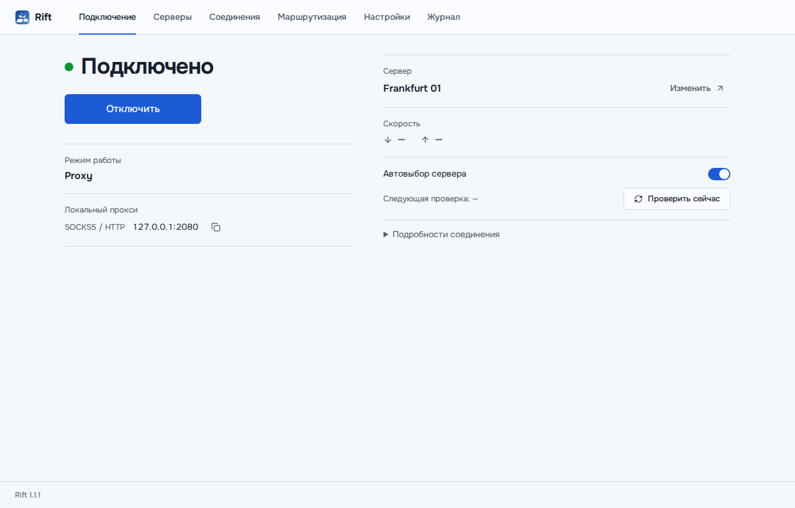

# Rift

Прокси-клиент для Windows 10/11 x64 на Xray и sing-box. Поддерживает VLESS/Reality, VMess, Trojan и Shadowsocks.

Добавьте подписку или ссылку сервера, подключитесь и оставьте выбор сервера автоматике. Есть TUN, локальный HTTP/SOCKS5-прокси и правила маршрутизации. Интерфейс на русском.

Код сгенерирован ИИ; идеи, логика, дизайн, тестирование и ревью — работа человека.

[Скачать](https://github.com/rift-proxy/rift-desktop/releases) · [Установить](docs/install.md) · [Начать пользоваться](docs/usage.md) · [Если не работает](docs/troubleshooting.md)

## Зачем Rift

Если в подписке много серверов, выбирать и перепроверять их вручную неудобно. Rift берёт эту работу на себя:

- **Проверяет соединение через прокси**, а не только доступность порта.
- **Не переключается из-за каждого колебания задержки.** При полном пуле меняет стабильно работающий сервер, только если другой лучше заданных порогов (настраиваются).
- **Возвращает восстановившиеся серверы в выбор.** Не отвечающие проверяются отдельно.
- **Оставляет ручной выбор.** Можно выбрать сервер самому, не отключая "Автовыбор". После он сравнивается с остальными на общих условиях.

## Что ещё умеет

- Подписки, ссылки серверов и импорт QR-кодов.
- TUN для трафика системы или локальный HTTP/SOCKS5-прокси для отдельных приложений.
- Правила маршрутизации и профили настроек.
- Работа в Proxy без прав администратора.

Ошибки остаются в локальном журнале. Автоматической отправки нет. [Какие данные хранятся](docs/privacy.md).

## Перед установкой

Rift не предоставляет серверы: понадобится своя подписка или ссылка подключения. Поддерживаются Windows 10/11 x64; интерфейс на русском. В режиме Proxy клиент не меняет системные настройки прокси.

## Разработка

[Сборка из исходников](docs/build.md) · [Участие](CONTRIBUTING.md) · [История версий](CHANGELOG.md) · [Сообщить об уязвимости](SECURITY.md)

Лицензия [MIT](LICENSE). Лицензии сторонних компонентов собраны в [THIRD-PARTY-NOTICES.md](THIRD-PARTY-NOTICES.md).
